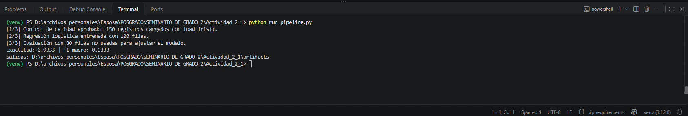
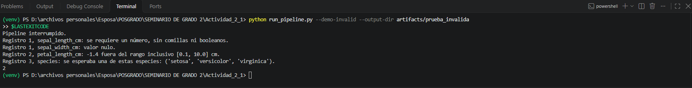

# Actividad 2.1 – Estandarización de Pipelines y Control de Calidad de Datos

## Objetivo

Implementar un pipeline reproducible para clasificar flores Iris que se pueda
ejecutar con un solo comando. El proceso valida los datos de entrada antes de
entrenar, ajusta un modelo de regresión logística y evalúa su desempeño en un
conjunto de prueba separado. El proyecto retoma el dataset Iris de la
Actividad 1.1. En esta actividad, el énfasis está en la automatización y el
control de calidad de los datos.


---

## Requisitos

Antes de iniciar, verificar que se encuentre instalado:

- Python 3.12 (versión de referencia para las dependencias del proyecto).
- Visual Studio Code, recomendado.
- Extensión de Python para Visual Studio Code, opcional.
- Git, opcional.

Iris se carga mediante `sklearn.datasets.load_iris()` después de instalar
scikit-learn. No se debe descargar, crear ni subir un CSV del dataset.

---

## 1. Crear la carpeta del proyecto

Crear una carpeta llamada `Actividad_2_1` y abrirla desde Visual Studio Code.

---

---

# 2. Crear el entorno virtual
Abrir una terminal en VS Code.
En Windows PowerSheel de Visual Studio code ejecutar:
```
python -m venv venv
```

Activar el entorno virtual:

En Windows PowerShell de Visual Studio Code ejecutar:
```
venv\Scripts\activate
```

Si PowerShell bloquea la ejecución de scripts, ejecutar primero:
```powershell
Set-ExecutionPolicy -Scope Process -ExecutionPolicy RemoteSigned
```
Luego volver a activar el entorno:
```powershell
venv\Scripts\activate
```
Cuando el entorno esté activo deberá aparecer
`(venv)`
al inicio de la línea de comandos.


## 3. Instalar las dependencias
Verificar que `requirements.txt` contenga las siguientes versiones:

```text
numpy==2.3.5
scipy==1.17.0
scikit-learn==1.8.0
joblib==1.5.3
threadpoolctl==3.6.0
```

Desde la misma terminal, ejecutar:

```powershell
python -m pip install -r requirements.txt
```
---

## 4. Ejecutar el pipeline

Después de instalar las dependencias, ejecutar el flujo completo con un solo
comando:

```powershell
python run_pipeline.py
```

El comando realiza estas tres etapas en orden:

1. **Carga y control de calidad.** Llama a `load_iris()`, convierte las
   observaciones a registros de Python en memoria y los valida. Si falla
   el control de calidad, la ejecución se detiene antes de entrenar.
2. **Entrenamiento.** Separa el 80% de las observaciones para entrenamiento y
   el 20% para prueba, de forma estratificada y con semilla 42. El escalador
   y el modelo de regresión logística se ajustan solo con el conjunto de
   entrenamiento.
3. **Evaluación.** Calcula la exactitud, el F1 macro y la matriz de confusión
   sobre las 30 flores del conjunto de prueba.

Una ejecución exitosa genera:

| Archivo | Contenido |
|---|---|
| `artifacts/model.joblib` | Modelo entrenado con su preprocesamiento. |
| `artifacts/metrics.json` | Métricas, matriz de confusión, configuración de la partición, origen del dataset y huellas de los registros y del contrato. |

---

## 5. Verificar el control de calidad

El validador comprueba que cada registro tenga los campos requeridos y que
las mediciones sean numéricas, finitas, no nulas y estén dentro de los rangos
del contrato. En entrenamiento, cada registro incluye la variable objetivo
`species`, con valores `setosa`, `versicolor` o `virginica`. Se requieren
al menos cinco registros por especie. Estas comprobaciones no utilizan
librerías externas.

| Variable | Medición | Rango permitido en cm |
|---|---|---:|
| `sepal_length_cm` | Longitud del sépalo | 0,1 a 12,0 |
| `sepal_width_cm` | Ancho del sépalo | 0,1 a 8,0 |
| `petal_length_cm` | Longitud del pétalo | 0,1 a 10,0 |
| `petal_width_cm` | Ancho del pétalo | 0,1 a 5,0 |

Los límites son inclusivos y se definieron como reglas de calidad para el
ejercicio. Estar dentro del rango no garantiza que una observación sea
representativa de los datos con los que se entrenó el modelo.

Validar el dataset original:

```powershell
python run_pipeline.py --validate-only
```

**Probar el pipeline con errores introducidos en memoria: un texto donde se
espera un número, un valor nulo, una medición negativa y una especie no
admitida. Esta opción no modifica el dataset original ni requiere un archivo:**

```powershell
python run_pipeline.py --demo-invalid --output-dir artifacts/prueba_invalida
$LASTEXITCODE
```

En este caso, el resultado esperado es **«Pipeline interrumpido»**, con los
errores identificados por registro y campo y el código de salida `2`. El flujo
no debe llegar a la etapa de entrenamiento ni generar un modelo nuevo.

---

## 6. Probar el contrato de datos para inferencia

El archivo [`data_contract.json`](data_contract.json) es el contrato de
entrada. Define un objeto JSON con las cuatro mediciones de una flor,
incluye un ejemplo válido en `examples` y un ejemplo inválido en
`x-invalid-example`. No se envía `species` en la entrada porque es lo que
se quiere predecir.

```powershell
python predict.py --example valid
python predict.py --example invalid
```

- **Ejemplo válido.** Devuelve `{"species": "setosa"}`.
- **Ejemplo inválido.** Rechaza la entrada por una medición escrita como
  texto, otra nula y otra fuera de rango. Devuelve el código `2` antes de
  cargar el modelo.

Para probar una flor diferente, guardar un objeto JSON con los cuatro campos
en `mi_flor.json` y ejecutar:

```powershell
python predict.py --input mi_flor.json
```

---

## 7. Ejecutar las pruebas y registrar la evidencia

Ejecutar la suite de pruebas:

```powershell
python -m unittest discover -s tests -v
```

La suite debe terminar con **14 pruebas y `OK`**. Incluye pruebas de tipos,
nulos, rangos, campos ausentes, consistencia del contrato y bloqueo del
entrenamiento cuando los registros no cumplen las reglas.


**Evidencias**

*Pipeline exitoso* 



*Pipeline con datos inválidos*




---

## Estructura del proyecto

```text
Actividad_2_1/
├── README.md
├── requirements.txt
├── run_pipeline.py
├── validate_data.py
├── data_contract.json
├── predict.py
├── tests/
├── docs/evidencias/     # Capturas de ejecución
└── artifacts/           # Archivos generados localmente
```

---

## Resultado esperado

Con Iris cargado mediante `load_iris()` y las dependencias declaradas, la ejecución de
referencia valida **150 observaciones**, entrena con **120** y evalúa con
**30**. El modelo acierta **28 de 30** (exactitud de **93,33%**) y obtiene
un **F1 macro de 0,9333**. Estos valores corresponden a una partición de
prueba de un dataset académico pequeño.

Además de obtener las métricas, el proyecto debe demostrar que un dato
inválido se rechaza antes de entrenar o de predecir.

---

## Fuentes

- Universidad Santo Tomás. (s. f.). *MLOps Open Source – Santoto. Semana 2:
  Pipelines y calidad*. https://dialvebe.github.io/mlops-course-santoto/#semana-2

- Fisher, R. A. (1936). *Iris* [Conjunto de datos]. UCI Machine Learning
  Repository. https://doi.org/10.24432/C56C76
- scikit-learn developers. (s. f.). *load_iris*. Documentación de
  scikit-learn 1.8. https://scikit-learn.org/1.8/modules/generated/sklearn.datasets.load_iris.html

El proyecto usa la versión corregida de Iris que se incluye en
scikit-learn 1.8.0. Al cargar el dataset se nombran los campos con sus
unidades y se convierten los códigos de clase en etiquetas de texto, todo en
memoria. UCI distribuye el dataset Iris bajo
[CC BY 4.0](https://creativecommons.org/licenses/by/4.0/).
